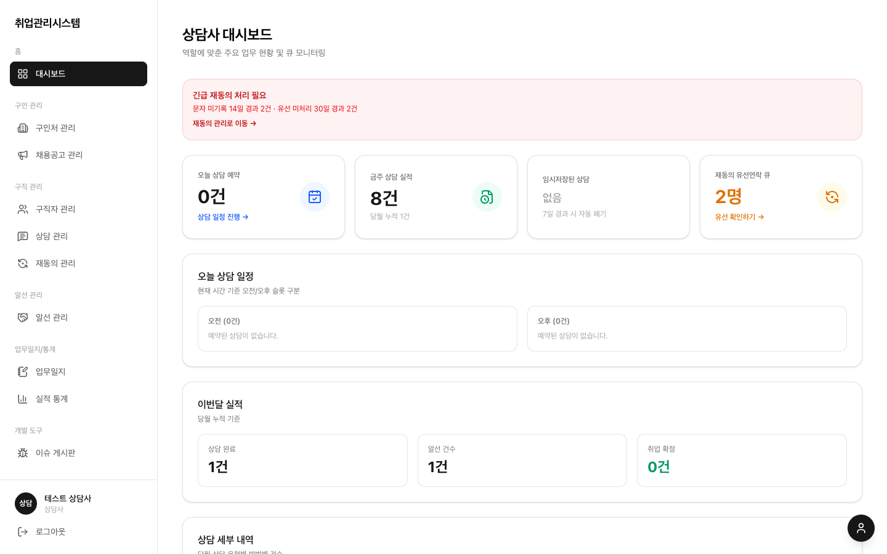

# 2.1 상담사

본인 담당 구직자의 상담 예약·진행·이력 관리를 맡습니다. 보이는 것도 만질 수 있는 것도 본인 담당이 원칙입니다.

## 하루 일과

1. **대시보드 확인**: [화면 · 대시보드](../screens/02-dashboard/)에서 오늘 상담 예약과 이번달 실적, 재동의 유선확인 큐를 봅니다
2. **상담 예약 확인**: [화면 · 상담 관리](../screens/06-supports/)에서 오늘의 일정 카드에 뜬 본인 담당 예약을 확인합니다 (예약이 없으면 카드가 나타나지 않습니다)
3. **상담 진행·기록**: 일정 카드의 **상담 시작**을 누르면 상담 화면(`/supports/create`, 예약 정보가 미리 채워짐)으로 이동합니다. 요약·상세·다음 계획을 작성하고 **상담 완료**를 눌러야 기록이 저장되고 실적 1건으로 집계됩니다 (버튼을 누른다고 바로 완료되지 않습니다). 작성 중 30초마다 자동 임시저장(7일 보관)되니 날아갈 걱정은 없습니다
4. **유선확인 처리**: [화면 · 재동의 관리](../screens/08-consent/)에서 본인 담당 '유선확인 필요' 건에 연락하고 결과를 기록합니다 (상담 실적 1건으로 자동 반영)
5. **업무일지 제출**: [화면 · 업무일지](../screens/09-worklogs/)에서 시간대를 선택하고 비고를 적어 완결 제출합니다. 당일 실적은 자동 집계됩니다
6. **본인 실적 확인**: [화면 · 실적 통계](../screens/10-statistics/)에서 본인 KPI를 봅니다

## 할 수 있는 일 / 없는 일

- ○ 구직자 등록 (담당은 본인으로), 본인 담당 구직자 상세·댓글 작성
- ○ 본인 담당 예약의 등록·수정·취소/노쇼 (완료 처리는 상담 화면에서 기록과 함께)
- ○ 본인 담당 재동의 유선확인 처리
- ✕ 타인 담당 구직자·예약·재동의 대상 조회·수정 (목록에 안 보이고 직접 접근해도 차단)
- ✕ 구인처·공고 등록 (`/companies/create`·`/offers/create` 접근 차단)
- ✕ 재동의 문자 발송, 목록 엑셀 다운로드, 팀 전체 통계 조회

## 주의점

- 구직자 등록 시 담당 상담사를 본인으로 설정해야 저장됩니다
- 상담 기록은 구직자 상담 / 구인처 상담 중 하나만 선택하세요 (둘 다 선택하면 저장 안 됨)
- 로그아웃 후에는 브라우저를 닫아주세요 (뒤로가기로 이전 화면이 보일 수 있음, 세션은 파기된 상태)
