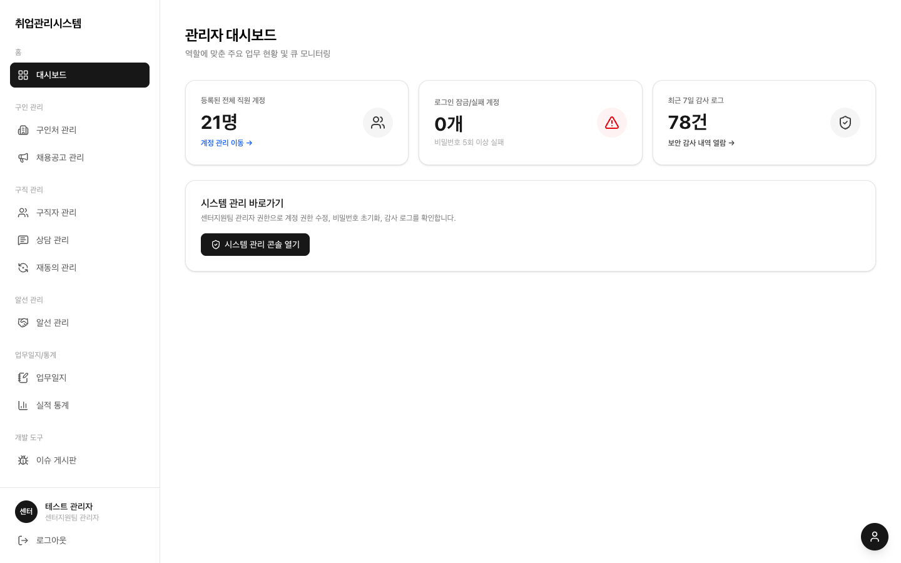

# 2.4 센터지원팀 관리자

계정·역할·보안·감사를 전담하는 '열쇠 관리자'입니다. 알선·업무일지는 읽기 전용으로 열람하고, 실적 통계는 전 역할과 동일한 전체 수치를 봅니다.

## 하는 일

1. **모니터링**: [화면 · 대시보드](../screens/02-dashboard/)에서 최근 7일 계정 변경 이력, 감사 로그 이상 징후, 접근 실패·계정 잠금 현황을 봅니다
2. **계정 관리**: [화면 · 시스템 관리](../screens/11-system/)에서 계정 생성·역할 부여·비활성화·비밀번호 초기화·잠금 해제를 합니다. master 역할 부여는 master만 할 수 있습니다
3. **감사 추적·엑셀**: 시스템 관리의 감사 로그 탭에서 민감정보 열람·대량 다운로드·권한 변경 이벤트를 확인하고, 필요시 사유(10자 이상)를 적어 엑셀로 저장합니다 (저장 자체가 감사 로그에 남습니다)
4. **파기 실행**: [화면 · 시스템 관리](../screens/11-system/)의 데이터 파기 탭에서 소프트 삭제 30일 경과 건을 완전히 삭제합니다. 실행 전 미리보기에서 대상을 반드시 확인하세요
5. **마이페이지**: 좌측 하단 내 계정에서 여는 마이페이지 모달에서 본인 비밀번호를 직접 바꿀 수 있습니다

## 열 수 없는 것 (정상 동작)

- ✕ 재동의 연락·기록·복구 (조회만 가능 — 행위와 복구는 상담사·담당자 권한)
- ✕ 구인처·공고 등록, 알선 생성·진행 (조회는 읽기 전용으로 가능)
- ✕ master 계정의 비활성화·비밀번호 변경, master 역할 부여 (master만 가능)

## 주의점

- 초기 비밀번호를 비워두면 12자리 랜덤으로 생성되며 화면에 1번만 표시됩니다. 전달 시 메모해 두고, 신규·초기화 계정은 첫 로그인 시 비밀번호 변경이 강제되니 미리 안내해 주세요
