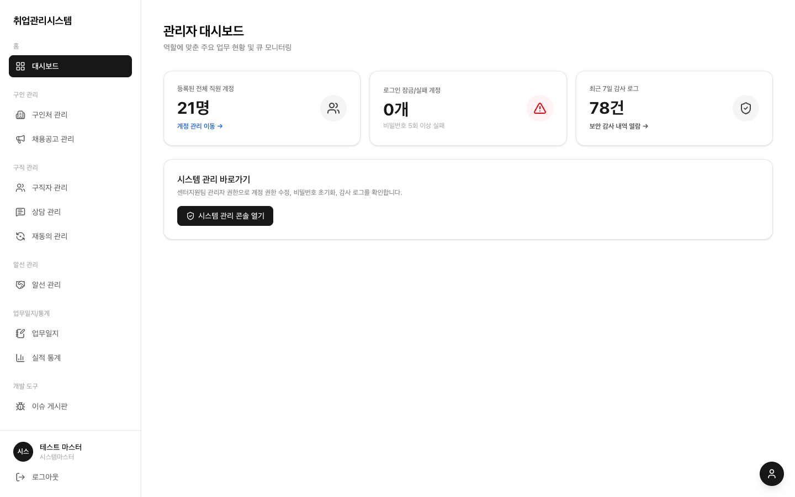

# 2.5 시스템 마스터

시스템 최고 권한이지만 실무 데이터를 마음대로 바꾸지는 못하는 역할입니다. 볼 수는 있고 바꿀 수는 없게 막혀 있습니다 (최고 권한 남용 방지). 유일하게 할 수 있는 일이 최종 파기입니다.

## 하는 일

1. **전체 조회**: 모든 메뉴를 조회할 수 있습니다. [화면 · 시스템 관리](../screens/11-system/)의 감사 로그도 확인합니다
2. **파기 실행**: [화면 · 시스템 관리](../screens/11-system/)의 데이터 파기 탭에서 소프트 삭제 후 30일이 지난 구직자를 완전히 삭제합니다. 실행 전 미리보기에서 대상을 확인하고, 실행 결과는 파기 감사 로그에 남습니다. 통계 데이터는 비식별 형태로 보존됩니다
3. **계정 관리**: 계정 생성·수정·비활성화·초기화·잠금 해제를 할 수 있고, master 역할 부여도 가능합니다 (admin은 master 부여 불가)
4. 그 외 재동의 연락·기록·일괄 변경 같은 실무 데이터 수정은 읽기 전용으로 차단됩니다

## 주의점

- 파기는 되돌릴 수 없습니다. 실행 전 보관함에서 대상과 30일 경과 여부를 반드시 확인하세요
- 초기 비밀번호를 비워두면 12자리 랜덤으로 생성되며 화면에 1번만 표시됩니다
