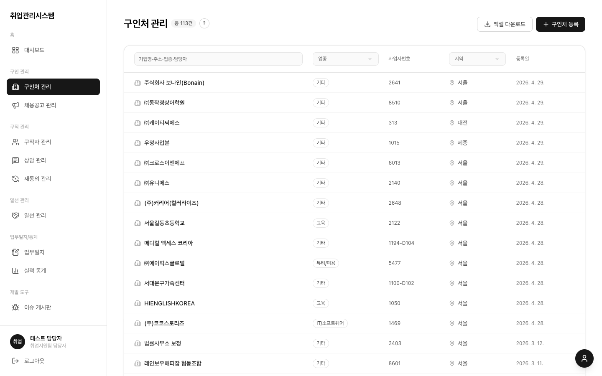
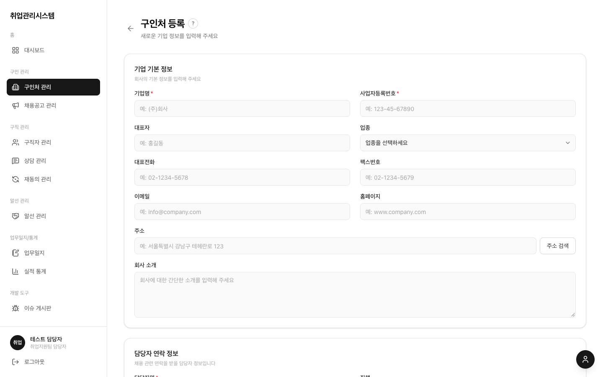
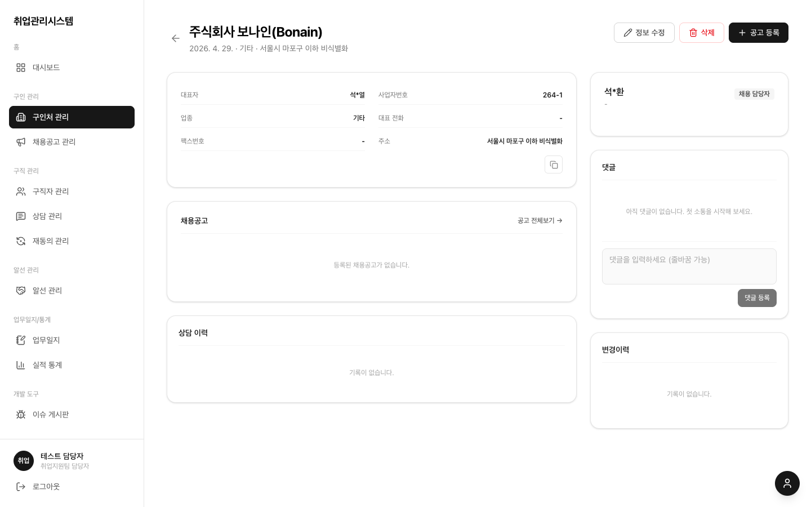

# 1.3 구인처 관리

## 이 화면에서 할 수 있는 일 (역할별)

| 행위 | 상담사 | 담당자(staff) | 관리자(admin) | 마스터 |
|:---|:---:|:---:|:---:|:---:|
| 목록 조회 | ○ | ○ | 제한적 | ○ |
| 등록·수정 | ✕ (등록 페이지 접근 차단) | ○ (독점) | ✕ | ○ |
| 목록 엑셀 다운로드 | ✕ | ○ | ○ | ○ |

- 상담사 계정으로 `/companies/create`에 직접 접근해도 차단됩니다 (화면 가림이 아니라 실제 차단)
- 엑셀에는 담당자/연락처/이메일 컬럼이 포함되지 않습니다 (개인정보 보호, 빠진 것이 정상)

## 목록

좌측 메뉴 **구인처 관리**를 클릭합니다. 헤더에 **총 N건** 뱃지와 `?` 이용 안내, 우측에 **엑셀 다운로드**(staff/admin/master)와 **구인처 등록**(staff) 버튼이 있습니다.

- 검색·필터는 표 머리(th)에서 바로 선택합니다: 기업명 검색(TextInput, Enter 제출·× 지우기) + 업종/지역 다중선택(선택 후 약 1초 뒤 자동 제출)
- 목록은 20건/페이지로 표시됩니다. 필터 조건은 엑셀 다운로드에도 그대로 반영됩니다
- 업종은 표준 14종 카테고리 기준이며, 칩에 마우스를 올리면 이관 원문 툴팁이 표시됩니다
- 지역 컬럼: 주소에서 파생된 시/구 축약 표시
- ※ 담당자 연락처는 목록에 노출되지 않고 상세 화면에서만 열람됩니다 (PRD 2.1.2)

## 등록 (staff)

**구인처 등록** 버튼을 클릭하면 전용 등록 페이지(`/companies/create`)가 열립니다. 기업 기본정보와 담당자 연락정보를 입력합니다.

- 사업자번호는 숫자만 입력해도 하이픈이 자동 적용됩니다 (`000-00-00000`)
- 주소는 **주소검색 팝업**으로 입력합니다
- 담당자 연락처·이메일은 암호화 저장되며, 변경 시 변경이력이 남습니다
- 회사 소개 등 확장 정보는 함께 저장됩니다

## 상세 · 수정 · 삭제

목록에서 기업명을 클릭하면 상세(`/companies/[id]`)가 열립니다. 좌(본문: 법인 정보 → 채용공고 → 상담이력) / 우(담당자 카드 → 댓글 → 변경이력) 2단 구성입니다.

- 담당자 연락처·이메일은 우측 담당자 카드에서 확인합니다 (목록에서는 안 보이고 상세에서만 보이면 정상)
- **댓글**은 담당자 간 공유 메모이며 작성자 본인만 수정·삭제할 수 있습니다. **변경이력**은 "담당자 연락처, 담당자 이메일 변경" 같은 문장형으로 표시됩니다
- **정보 수정**은 `/companies/[id]/edit`에서 등록 폼과 같은 화면으로 수정합니다 (PII는 바뀐 값만 재암호화)
- **삭제**: 연결된 미취소 공고·알선이 있으면 먼저 취소·정리하라는 안내와 함께 차단됩니다
