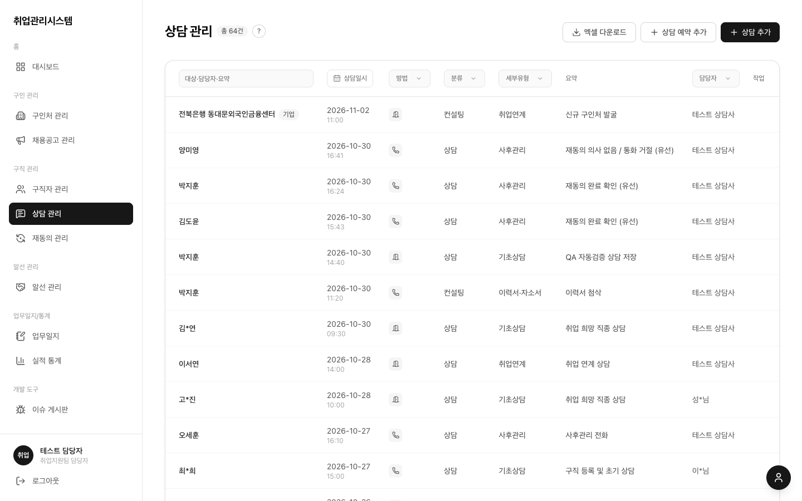

# 1.6 상담 관리

## 이 화면에서 할 수 있는 일 (역할별)

| 행위 | 상담사 | 담당자(staff) | 관리자(admin) | 마스터 |
|:---|:---:|:---:|:---:|:---:|
| 예약 등록·수정·취소/노쇼 | 본인 담당만 | 전체 (담당자 변경·취소 제어) | ✕ (조회만 가능) | ✕ (조회만 가능) |
| 상담 기록 작성 (`/supports/create`) | 본인 담당 위주 | 전체 | ✕ | ○ |
| 상담 기록 수정 (`/supports/{id}`) | 본인 작성·7일 이내만 | 본인 작성·7일 이내만 | ✕ | ○ (전체) |
| 목록 엑셀 다운로드 | ✕ | ○ | ○ | ○ |

좌측 메뉴 **상담 관리**를 클릭합니다. 상단 헤더(총 건수 + 도움말 `?` + 엑셀/예약 추가/상담 추가 버튼), ① 오늘의 상담 일정, ② 상담 이력(메인 표) 순으로 표시됩니다.

## ① 오늘의 상담 일정 (예약 = 약속, 오늘만)

오늘 날짜의 예약만 표시되는 확인용 카드입니다. 예약이 없으면 카드 자체가 나타나지 않습니다.

- 행 구성: 시각 │ 방법 아이콘(방문=파랑/유선=초록) │ 구직자명+요약 │ 상담내용·세부유형·담당자 pill │ 상태(`예약`) │ **상담 시작** · 취소
- **상담 시작**은 상담 화면(`/supports/create?talentId=..&reservationKey=..`, 예약 정보 프리필)으로 **이동**합니다. 버튼을 누른다고 예약이 바로 완료되지 않습니다 (기록 없는 완료 방지)
- 취소는 다이얼로그에서 **사유 필수 + 노쇼 체크박스**로 처리합니다 (노쇼 체크 여부에 따라 상태가 나뉨)
- 예약 등록·수정은 우측 **상담 예약 추가** 드로어에서 합니다. staff는 담당 상담사를 자유 지정할 수 있고, 상담사는 본인 담당 예약만 등록·수정할 수 있습니다

## ② 상담 이력 (기록 = 실적, 화면의 주인공)

실제 진행된 상담 기록이 최신순으로 표시되는 메인 표입니다 (20건/페이지). **상태 필터는 없습니다** (기록에는 상태 컬럼이 없음).

- 열 구성 8개: 상담 대상 │ 상담일시(날짜/시간 2줄) │ 방법 │ 분류(상담내용) │ 세부유형 │ 요약 │ 담당자 │ 작업
- 필터는 표 머리(th)에서 바로 선택합니다: 검색어 │ 일자 범위(달력 팝업) │ 방법 │ 분류 │ 세부유형 │ 담당자. 변경 즉시 목록에 반영됩니다
- 상담 대상(첫 열)을 클릭하면 기록 상세(`/supports/{id}`)로 이동합니다
- 작업 열의 **수정**은 작성자 본인이 작성 후 7일 이내일 때(또는 master)만 보입니다. 그 외에는 읽기 전용으로 열립니다 (입력 비활성화, 저장 버튼 숨김)
- 헤더 **엑셀 다운로드**(staff/admin/master)는 현재 필터 결과 전체를 저장합니다 (페이지 무관, 최대 10,000행)
- 예약 없이 진행된 상담(워크인)은 헤더 **상담 추가**(`/supports/create`)에서 바로 기록합니다

## ③ 상담 기록 작성·수정

- 신규 작성은 `/supports/create` (예약에서 넘어오면 구직자·예약키가 미리 채워짐). 옛 주소 `/supports/session`은 새 주소로 자동 이동(301)됩니다
- **구직자 상담 / 구인처 상담 중 하나만 선택**: 구직자 상담이면 구직자를, 구인처 상담이면 구인처를 채웁니다. 둘 다 선택하면 저장되지 않습니다 (화면 검증 + DB 제약 이중 차단)
- **30초 자동 임시저장**: 작성 중 30초마다 자동 저장되고 브라우저에 7일간 보관됩니다 (7일 경과 시 자동 폐기). 완료 처리되면 임시저장은 삭제됩니다
- 상담 완료 시 **실적 1건**으로 자동 집계되고, 예약에서 시작한 경우 예약과의 연결은 감사 로그 1건으로만 남습니다 (`supports`에 예약키를 저장하지 않음). 예약 종료에 실패해도 기록은 유지되고 화면에 경고가 표시됩니다
- 유선 재동의 연락 결과를 기록하면 상담 실적 1건(사후상담 유형)으로 자동 반영됩니다

## ④ 업무일지 반영 확인

당일 상담 건수가 업무일지에 자동 반영됩니다. 상담 완료 후 대시보드 "금일 상담" 수치가 +1 되는지, [화면 · 업무일지](./09-worklogs/)의 당일 집계에 잡히는지 확인해 보세요.
