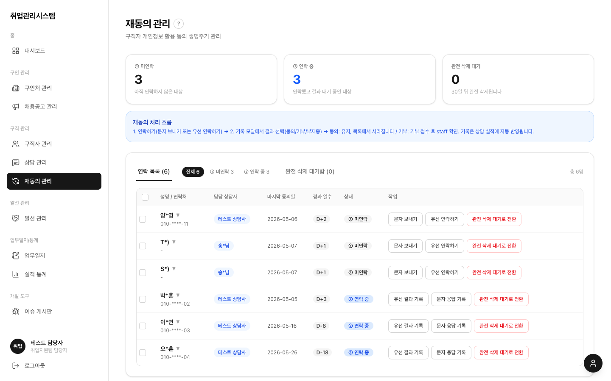

# 1.8 재동의 관리

개인정보 수집 동의 6개월 경과자를 대상으로 문자→유선 순서로 재동의를 받습니다. 응답이 없으면 목록에서 숨김(소프트 삭제) 처리되고, 30일이 지나면 완전 삭제(파기)됩니다.

## 이 화면에서 할 수 있는 일 (역할별)

| 행위 | 상담사 | 담당자(staff) | 팀장·관리자·마스터 |
|:---|:---:|:---:|:---:|
| 연락 목록 조회 | 본인 담당만 | 전체 | 전체 (조회 전용) |
| 문자 보내기(연락 시작 기록) | 본인 담당 ○ | ○ | ✕ |
| 유선 연락 결과 기록 | 본인 담당 ○ | ○ (대리 기록 가능) | ✕ |
| 일괄 처리 | ✕ (단건만) | ○ | ✕ |
| 완전 삭제 대기 → 복구 | ✕ | ○ (유일) | ✕ |
| 완전 삭제(파기) | ✕ | ✕ | 시스템 관리의 데이터 파기 탭에서 관리자·마스터만 |

연락하고 기록하는 건 상담사·담당자만 할 수 있고, 팀장·관리자·마스터는 보기만 됩니다.

좌측 메뉴 **재동의 관리**를 클릭합니다. 상단 카드 3개(① 미연락 · ② 연락 중 · 완전 삭제 대기) + 처리 흐름 안내 + 탭 2개(연락 목록 / 완전 삭제 대기함)로 구성됩니다.

1. **상단 카드 3개**: ① 미연락(아직 연락하지 않은 대상) · ② 연락 중(연락했고 결과 대기 중) · 완전 삭제 대기(30일 뒤 완전 삭제, 건수가 있으면 빨간색). 카드를 누르면 해당 목록으로 이동합니다
2. **연락 목록 탭**: 전체 / ① 미연락 / ② 연락 중 필터로 전환하며 확인합니다. 상태 뱃지(① 미연락·② 연락 중·거부 접수), D-day, 다음 연락 예정일이 표시되고, 목록의 연락처는 마스킹됩니다
3. **문자 보내기** (staff·상담사 본인 담당): 본인 휴대폰으로 문자를 보낸 뒤 화면에서 '문자 보내기'를 눌러 연락 시작으로 기록합니다. 문자 발송 = 연락 시작이며, 이후 결과(동의·거부·부재중)를 기록합니다
4. **유선 연락하기 / 결과 기록** (counselor 본인 담당, staff 대리 가능): 연락 결과를 기록하면 상담 실적 1건으로 자동 반영됩니다. 거부는 2단계(접수 후 staff 확정)로 처리됩니다
5. 처리 완료(재동의)된 건은 정상으로 돌아가 목록에서 사라집니다
6. **복구** (staff): 완전 삭제 대기함에서 미응답으로 숨김 처리된 구직자를 30일 이내에 정상 상태로 되돌릴 수 있는 유일한 권한입니다
7. **파기** (관리자·마스터): 완전 삭제 대기 30일 경과 건은 [화면 · 시스템 관리](./11-system/)의 데이터 파기 탭에서 완전히 삭제합니다. 통계 데이터는 비식별 형태로 보존됩니다
