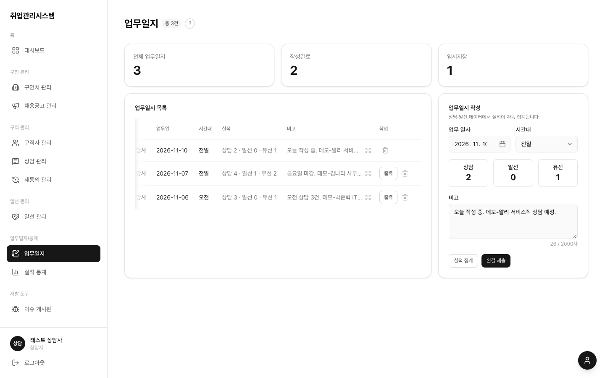

# 1.9 업무일지

하루의 상담·알선 실적을 정리해 제출하는 화면입니다. 작성은 상담사가 하고, 담당자·관리자·마스터는 목록을 조회·출력합니다.

## 이 화면에서 할 수 있는 일 (역할별)

| 행위 | 상담사 | 담당자·관리자·마스터 |
|:---|:---:|:---:|
| 작성·완결 제출·정정 | ○ | ✕ (작성 폼 미노출) |
| 목록 조회·출력(인쇄) | ○ | ○ |
| 비고 저장 (제출 후에도 가능) | ○ | ✕ |

좌측 메뉴 **업무일지**를 클릭합니다. 상단 카드 3개(전체·작성완료·임시저장) + 업무일지 목록(10건/페이지) + 우측 업무일지 작성 폼으로 구성됩니다. 목록 열은 상태 · 담당자 · 업무일 · 시간대 · 실적(상담·알선·유선) · 비고 · 작업입니다.

- **시간대 슬롯**: 전일/오전/오후 중 선택합니다. 같은 날짜에는 시간대와 무관하게 하루 1건만 제출할 수 있습니다
- **실적 자동 집계**: 당일 상담·알선·유선 건수가 자동으로 집계됩니다. [화면 · 상담 관리](./06-supports/)에서 완료 처리한 건이 여기 숫자에 반영되는지 확인해 보세요
- **완결 제출과 잠금**: 제출하면 입력 폼이 잠기고 다시 제출할 수 없습니다. 고쳐야 할 때는 **정정하기**로 정정 모드를 열어 저장합니다 (정정 이력이 감사 로그에 남습니다)
- **비고**: 제출 후에도 비고만 따로 저장할 수 있습니다
- **출력**: 목록 작업 열의 출력 버튼을 누르면 실제 양식 그대로 미리보기 새 창이 뜨고, 인쇄 확인 후 출력합니다. 출력한 일지는 상태가 **출력완료**(최초 출력 시각 표시)로 바뀝니다
