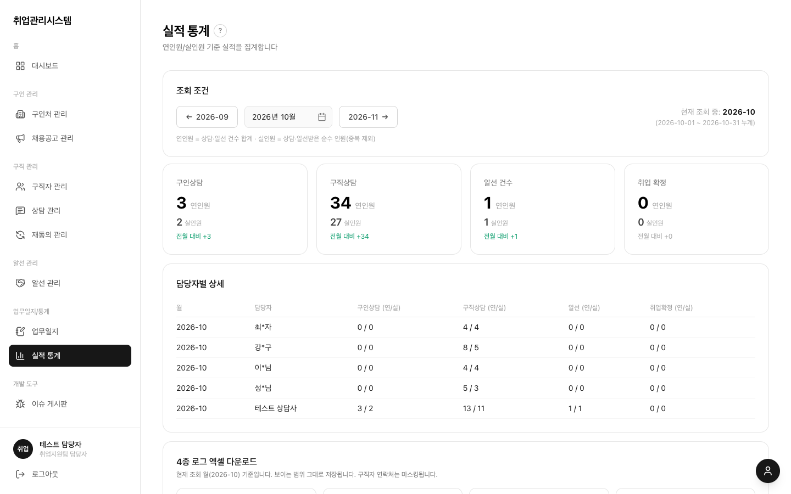

# 1.10 실적 통계

센터 전체 실적을 월 단위로 조회하는 화면입니다. 5개 역할 모두 같은 화면·같은 수치를 봅니다.

## 이 화면에서 할 수 있는 일 (역할별)

| 행위 | 상담사 | 담당자·팀장·관리자·마스터 |
|:---|:---:|:---:|
| 월별 실적 조회 | 전체 (동일) | 전체 (동일) |
| 4종 로그 엑셀 다운로드 | 본인 범위만 | 보이는 범위 그대로 (전체) |

좌측 메뉴 **실적 통계**를 클릭합니다. 조회 조건(월 이동) + 4개 KPI 카드 + 담당자별 상세 테이블 + 4종 로그 엑셀 다운로드 카드가 표시됩니다.

- **조회 조건**: 이전·다음 달 버튼 또는 월 입력으로 이동합니다. 상단에 `현재 조회 중: YYYY-MM`과 해당 월의 시작일~말일이 함께 표시됩니다
- **4개 KPI 카드**: 구인상담·구직상담·알선·취업확정별 연인원(상담·알선 건수 합계) / 실인원(중복 제외 순수 인원) + 전월 대비 증감
- **담당자별 상세 테이블**: 담당자별 월 실적 내역 (연/실 구분)
- **4종 로그 엑셀 다운로드**: 구인상담 로그 · 구직상담 로그 · 취업연계 로그 · 누계실적 카드를 누르면 현재 조회 월 기준으로 저장됩니다. 보이는 범위 그대로 저장되며(상담사는 본인 범위만), 구직자 연락처는 마스킹됩니다
