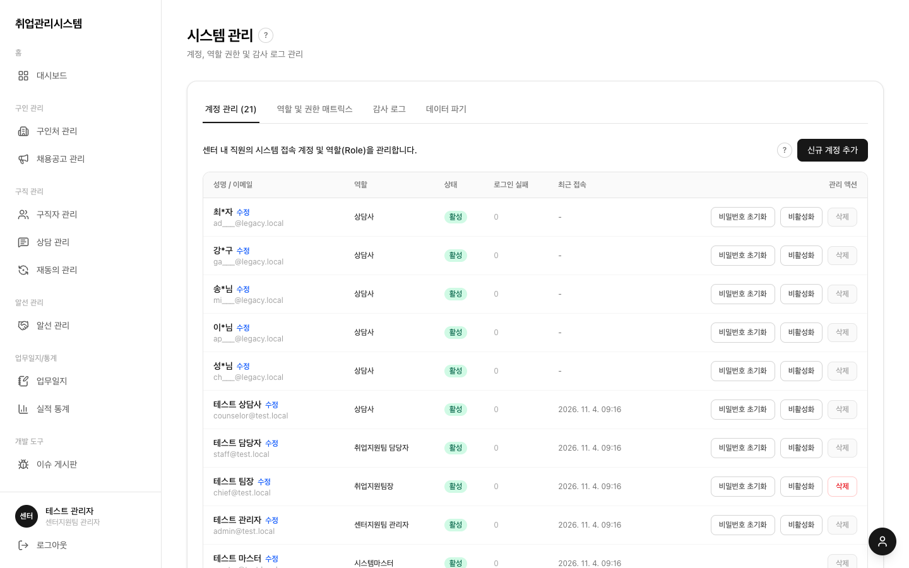

# 1.11 시스템 관리

계정·역할·감사 로그를 다루는 관리자 전용 화면입니다. 사이드바 **시스템 관리** 메뉴는 admin·master에게만 보이고, 나머지 역할은 메뉴 자체가 없고 `/system` 직접 접근도 차단됩니다.

## 이 화면에서 할 수 있는 일 (역할별)

| 행위 | 상담사·담당자·팀장 | 관리자(admin) | 마스터 |
|:---|:---:|:---:|:---:|
| 화면 접근 | ✕ (메뉴 숨김 + 직접 접근 차단) | ○ | ○ |
| 계정 생성·수정·비활성화 | ✕ | ○ | ○ (master 부여는 master만) |
| 비밀번호 초기화·잠금 해제 | ✕ | ○ | ○ |
| 감사 로그 조회·엑셀 내보내기 | ✕ | ○ | ○ |
| 완전 삭제(파기) 실행 | ✕ | ○ | ○ |

## 계정 관리 탭

센터 내 직원의 시스템 접속 계정과 역할을 관리합니다. 이름/역할/상태/로그인실패/최근로그인이 표시됩니다. 계정 목록 옆 `?`를 누르면 생성·초기비번·잠금해제·비활성화 안내가 팝업으로 뜹니다.

- **신규 계정 추가**: 우측 상단 버튼으로 계정을 생성하고 역할을 부여합니다. 초기 비밀번호를 비워두면 12자리 랜덤으로 생성되며, 화면에 1번만 표시되니 전달 시 메모해 두세요. master 역할 부여는 master만 할 수 있습니다
- **역할 변경**: 목록에서 직접 역할을 바꿀 수 있고, 변경 시 감사 로그에 기록됩니다
- **비밀번호 초기화·비활성화**: 퇴사·보직 변경 시 비활성화하고, 분실 시 초기화합니다. 초기화·신규 발급된 계정은 다음 로그인 시 비밀번호 변경 화면으로 강제 이동됩니다
- **잠금 해제**: 5회 실패로 잠긴 계정은 여기서 해제합니다 (해제 후 카운터 초기화). 관리자 계정까지 잠기면 마스터가 해제하고, 전부 막히면 DB에서 직접 해제합니다 ([부록 · 운영 안내](../reference/test-operations/) 참조)
- **내 비밀번호 변경**: 좌측 하단 내 계정을 누르면 열리는 마이페이지 모달에서 직접 바꿀 수 있습니다 (관리자 초기화 없이 본인이 변경)

## 역할 및 권한 매트릭스 탭

[부록 · 권한 매트릭스](../reference/permissions/)와 동일한 내용이 화면에 읽기 전용으로 표시됩니다. 본인 권한이 궁금할 때 여기서 확인하세요.

## 감사 로그 탭

민감정보 열람·대량 다운로드·권한 변경 같은 주요 이벤트를 추적합니다. 다운로드 자체도 감사 대상입니다.

- 필터 순서·명칭은 표(일시·수행자·대상·작업)와 같은 순서로 배치되어 있습니다. 건수는 탭이 아니라 표 위 `전체 N건 중 M건 표시`로 확인합니다
- 이벤트·대상·결과는 한국어 라벨로 표시됩니다 (예: 계정 생성, 비밀번호 초기화, 잠금 해제)
- **엑셀 다운로드**: 다운로드 버튼 → 사유 입력(10자 이상 필수) → 실행. 누가·언제·왜 받았는지 사유·건수·필터 조건과 함께 감사 로그에 자동 기록됩니다

## 데이터 파기 탭

소프트 삭제 후 30일이 지난 구직자를 완전히 삭제합니다. 관리자·마스터에게만 보입니다.

- 실행 전 **미리보기**에서 대상 목록(성명 가림 + 삭제 예정일·경과·딸린 알선/상담 건수)을 먼저 보여주고, 확인 모달을 거쳐 실행합니다
- 실행 결과와 실행자는 파기 감사 로그에 남습니다. 통계 데이터는 비식별 형태로 보존됩니다
- 파기는 되돌릴 수 없습니다. 실행 전 [화면 · 재동의 관리](./08-consent/)의 완전 삭제 대기함에서 대상과 30일 경과 여부를 반드시 확인하세요
